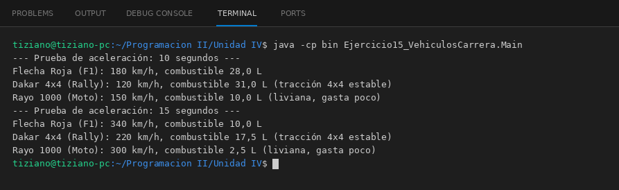

# VehiculoCarrera

Programación II - Unidad 4 - Ejercicio 15

## Consigna
Acelerar distintos vehículos de competencia con una misma orden y comparar su rendimiento.

## Lógica
- Clase abstracta `VehiculoCarrera` (nombre, velocidadActual, combustible) con `acelerar(int segundos)` y `obtenerDesempeno()`; el método protegido `incrementarVelocidad` respeta la velocidad máxima y el combustible disponible.
- `MonoplazaF1`, `AutoRally` y `Motocicleta` definen aceleración, velocidad máxima y consumo propios.
- `DirectorCarrera.correrPrueba(...)` recorre la lista de vehículos de forma polimórfica.
- `Main`: dos pruebas consecutivas; la moto se queda casi sin combustible.

## Ejecución

